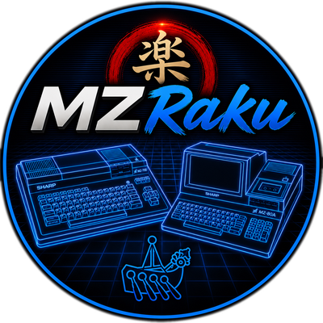
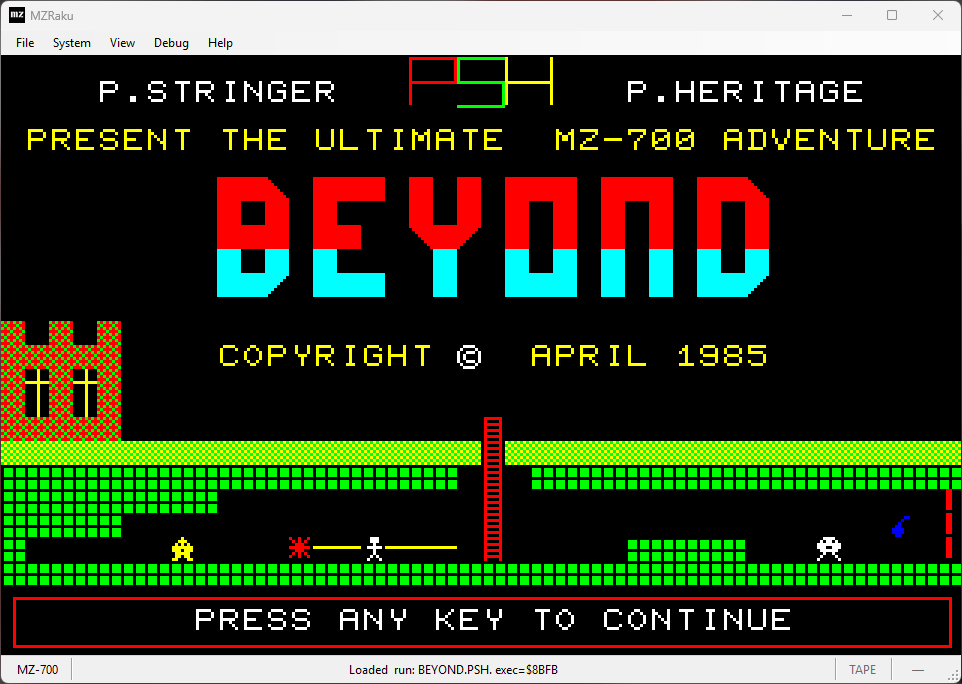
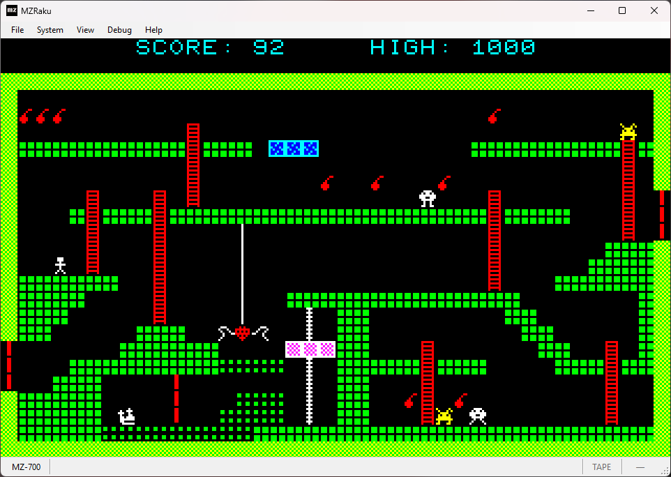

<p align="center"></p>

# MZRaku

A Sharp MZ-700, MZ-80A and MZ-800 emulator written in C# / .NET 8 (WinForms). The beginning aims of this emulator were:

1. Work well enough play the MZ-700 games I remember from my childhood
2. Be useable from a launcher such as Launchbox or Playnite, taking into account the need for a lot of games to have BASIC present before they can be loaded

This means that the goal for the emulator was to work 'well enough', and with some quality-of-life features to enable the above, without necessarily worrying too much about accurately reproducing how the actual hardware works. A good example of this is that MZRaku **does not** emulate the cassette loading in an 'accurate' way. Cassette images (regardless of type) are loaded by directly injecting them into the machine's memory, which meets the objective of loading games quickly and easily.

The emulator features have moved on substantially from my initial goals, with the addition of some other MZ machines, but still trying to achieve the same goals, and there are still a fairly ambitious set of features I'd like to include in the emulator going forward. The current development roadmap can be seen [here](/docs/roadmap.md).

***
IMPORTANT NOTE - The emulator code is *entirely* AI generated. Although I have some development experience, how CPUs etc work is outside my skillset so what is here is a result of several months of me working with Claude to produce the features and refinements I need for my use case. I chose to use C# as it is a language I know, so I can use how the project has been put together to educate myself on what it takes to create an emulator. The choice to use WinForms, effectively tying the current implementation tightly to Windows, was also made as it suits my specific needs.

Another aim was to see whether something like this is even possible using an AI tool. I think the result is pretty impressive. It's not perfect, but it does work. I think this is an appropriate use of these tools. I don't think anyone would be using a trivial emulator such as this for anything critical to their lives.

***

## Status

The emulator runs most MZ-700, MZ-80A and MZ-800 software and games, in both BASIC and machine code. There are some [outstanding limitations](#known-limitations) and things that aren't quite right. These are listed further down this file.

- Cassette images in `.mzf`/`.m12`/`.mzt` formats can be loaded via the menu, dragging and dropping them into the emulator window, or by specifying them on the command-line — the emulator will inspect the MZF and load BASIC and type 'RUN' automatically, if that is required to run the program. Machine-code programs are loaded and started directly. This flow works on all three machines.
- If your `.mzf`/`.m12`/`.mzt` files are within .zip archives, these can also be used directly in the same way as above. The emulator will automatically extract the .mzf file from the archive and run it.
- The default keyboard layout maps appropriate PC keys to the target machine's character set - e.g. typing a '+' on the PC keyboard will generate a '+' in the emulator, even though those keys are in relatively-different positions on actual hardware. An editor for the keyboard mappings is available under `System → Settings → Keyboard` for all three machines.
- MZRaku emulates the MZ-700's MZ-1X03 joystick and the MZ-800's two joystick ports via any Windows-recognised game controller. Button mappings can be changed via `System → Settings → Joystick`. The MZ-80A did not ship with a joystick.
- Text files containing BASIC listings can be loaded on all three machines. These are auto-typed into the emulator at about 6-8 chars per second. (Speeding this up will be a future focus)
- Each machine has its own guide: [MZ-700](docs/usage/mz700.md), [MZ-80A](docs/usage/mz80a.md) and [MZ-800](docs/usage/mz800.md).

**New in v1.5.0:**

- BASIC `SAVE` works on all three machines, writing an `.mzf` to a `saves\` folder, and **Insert cassette for LOAD…** now works on the MZ-80A too.
- The **Font Sheet** types graphic characters on all three machines: click one in BASIC and it's typed, switching mode for you if it needs to. On the MZ-700, characters no key can type come with the BASIC that puts them on screen.
- **Screenshots** (Ctrl+P), a **volume** control and **mute** (Ctrl+U), and **1× to 4× speed** (System → Speed, or `--speed=N`).
- New command-line options: `--settings=<ini>` runs with another settings file, `--insert=<cassette>` inserts a tape for the machine's own `LOAD`, and `--keys=<file>` plays a [script of keystrokes](docs/usage/keys-script.md).
- The MZ-800 ROM can be used as EmuZ-800's three separate files.
- The keyboard-mode pane on the status bar now works on all three machines, and the bugs parked in earlier releases are fixed, including the one where no keys typed after a keyboard remap until Ctrl+R.


## Quickstart

The emulator itself is freely available, but I have not included the Sharp ROM & font files or S-BASIC .mzf, all of which are really required to make the emulator useful. Other emulators seem to have included these, so I'm not necessarily worried about Sharp taking action, more about any Github rules and associated automated scanning that might make including them in the repo problematic.

You'll need to source the required files yourself (they are widely archived online) and drop them into the install directory. **MZ-700** (default):

| File | Where it goes | What it is |
|---|---|---|
| `1z-013a.rom` | `roms\` | The MZ-700 monitor ROM (4 KiB). |
| `mz700fon.int` | `roms\` | The MZ-700 character-generator ROM (font data). |
| `1Z-013B.mzf` | `basic\` (or `roms\`) | Sharp's S-BASIC interpreter, supplied on cassette. |

**MZ-80A** (only needed if you'll run `--mz80a`):

| File | Where it goes | What it is |
|---|---|---|
| `SA-1510.rom` | `roms\` | The MZ-80A monitor ROM (4 KiB). |
| `SA-CG.rom` | `roms\` | The MZ-80A character-generator ROM (font data). |
| `SA-5510.mzf` | `basic\` (or `roms\`) | Sharp's SA-5510 BASIC interpreter, supplied on cassette. |

**MZ-800** (only needed if you'll run `--mz800`):

| File | Where it goes | What it is |
|---|---|---|
| `MZ800.ROM` | `roms\` | The MZ-800's 16 KiB combined ROM (MZ-700 monitor, character generator, MZ-800 IPL and monitor). |
| `1Z-016.mzf` | `basic\` (or `roms\`) | Sharp's MZ-800 BASIC interpreter, supplied on cassette. |

If you have the MZ-800 ROM as three separate files, as EmuZ-800 uses (`MZ700IPL.ROM`, `FONT.ROM` and `MZ800IPL.ROM`), put those in `roms\` instead: see the [MZ-800 guide](docs/usage/mz800.md#getting-started).

Layout next to `MZRaku.exe`:

```
MZRaku.exe
roms\
  1z-013a.rom
  mz700fon.int
  SA-1510.rom       (only if running --mz80a)
  SA-CG.rom         (only if running --mz80a)
  MZ800.ROM         (only if running --mz800)
basic\
  1Z-013B.mzf
  SA-5510.mzf       (only if running --mz80a)
  1Z-016.mzf        (only if running --mz800)
```

The first launch scans these folders, records the resolved paths in `settings.ini` (split into `[Roms.MZ700]`, `[Roms.MZ80A]` and `[Roms.MZ800]` sub-sections), and starts the emulator. If a file is missing the emulator reports it and tells you exactly where it looked to find them.

### Using the emulator from a game launcher

One of the primary objectives of MZRaku is to make it much easier to launch MZ-700 games from launcher applications, so that games can be selected and will start automatically, even with the quirk of needing BASIC to be pre-loaded for most titles. This should be straightforward if you have configured other emulators within your launcher of choice, but see [Launcher setup](docs/usage/launcher-setup.md) for step-by-step instructions on wiring MZRaku into popular Windows game launchers (Launchbox so far, more to follow soon - notably Playnite).

## Building & running

The Z80 CPU emulator lives in a separate repo
([sgillon/Z80Core](https://github.com/sgillon/Z80Core)) and is
included here as a git submodule. After cloning:

```
git submodule update --init
dotnet build
dotnet run
```

If you cloned with `git clone --recurse-submodules`, the submodule step is already done.

Or once built:

```
.\[Working dir]\MZRaku.exe [--basic] [path\to\cassette.mzf]
```

### Producing a release build

```
dotnet publish -c Release -r win-x64 --self-contained false -o publish\MZRaku
```

Release publishes a single self-extracting `MZRaku.exe` which assumes the .NET 8 DesktopRuntime is installed on the target machine. Place your ROMs / BASIC alongside the exe as per [Quickstart](#quickstart) above.

## Command-line options

| Flag | Effect |
|---|---|
| `--mz700` | Force MZ-700 for this run. Overrides `[Machine] DefaultMachine=` in `settings.ini` without writing back. MZ-700 is also the default when nothing is specified. |
| `--mz80a` | Force MZ-80A for this run. Overrides `[Machine] DefaultMachine=` in `settings.ini` without writing back. |
| `--mz800` | Force MZ-800 for this run. Overrides `[Machine] DefaultMachine=` in `settings.ini` without writing back. |
| `--basic` (`-b`) | Auto-load the active machine's BASIC (S-BASIC on MZ-700, SA-5510 on MZ-80A, 1Z-016 on MZ-800) after the monitor is ready. Implied automatically if a BASIC program cassette file is also specified. |
| `<path>.mzf` | Auto-load a cassette image. BASIC programs will auto-load BASIC, then `RUN` will be typed automatically; machine-code images load and start directly. A `.zip` containing an `.mzf`/`.m12`/`.mzt` entry is also accepted (the first cassette entry within the archive is used). |
| `--display=N` | Override the window scale for this run: `1`, `2`, `3`, or `full`/`fs` for borderless full-screen. settings.ini is not modified — Alt+Enter or the View menu still toggle out of full-screen. |
| `--scanlines[=on\|off]` | Force the CRT-style scanlines overlay on or off for this run. Without the flag the persisted Settings → Display value wins. Doesn't write back to settings.ini unless you also touch the View → Scanlines toggle or open Settings. |
| `--settings=<ini>` | Run with another settings file, read-only: nothing this run changes is written back to it (or to `settings.ini`). The title bar names it. |
| `--insert=<cassette>` | Insert a cassette for the machine's own `LOAD`, as File → Insert cassette for LOAD… does, without loading it for you. |
| `--keys=<file>` | Play a script of keystrokes, each at a set frame. See [Scripted keys](docs/usage/keys-script.md). |
| `--speed=N` | Start at `N` times real speed: `1`, `2`, `3` or `4`. Sound is off while it isn't 1×. Without the flag every run starts at 1×; System → Speed changes it. |
| `--dump=<file>` | At frame 120 (configurable using `--dumpframe` below), dump CPU/PIT/PPI/VRAM state to a text file and exit — useful for offline diagnostics. |
| `--dumpframe=N` | Override the dump frame number used for `--dump` above. |
| `--help` (`-h`) | Show usage. |

Examples:

```
MZRaku.exe                                 # boot into MZ-700 (default)
MZRaku.exe --basic                         # MZ-700 + S-BASIC loaded, prompt at Ready
MZRaku.exe cricket.mzf                     # MZ-700 BASIC game, auto-LOAD + auto-RUN
MZRaku.exe --mz80a                         # boot into MZ-80A monitor
MZRaku.exe --mz80a --basic                 # MZ-80A + SA-5510 BASIC
MZRaku.exe --mz80a NEW-INVADERS-80A.mzf    # MZ-80A machine-code game
MZRaku.exe --mz800                         # boot into the MZ-800 IPL boot menu
MZRaku.exe --mz800 --basic                 # MZ-800 + 1Z-016 BASIC
MZRaku.exe --mz800 game.mzf                # MZ-800 game (BASIC or machine code)
MZRaku.exe --speed=4 cricket.mzf           # the same game at 4× speed (no sound)
MZRaku.exe --basic --insert=game.mzf       # S-BASIC at Ready, tape ready for LOAD
```

## Menu and shortcuts

Menu bar is `File / System / View / Debug / Help`.

| Menu | Action | Shortcut |
|---|---|---|
| File | Load cassette… | Ctrl+O |
| File | Insert cassette for LOAD… | — |
| File | Load BASIC | Ctrl+B |
| File | Load BASIC source… | Ctrl+Shift+B |
| System | Machine → MZ-700 / MZ-80A / MZ-800 | — |
| System | Reset | Ctrl+R |
| System | Pause emulator | Pause / ScrLk |
| System | Sound → Mute | Ctrl+U |
| System | Sound → Volume | — |
| System | Speed → 1× / 2× / 3× / 4× | — |
| System | Settings → Startup… | Ctrl+S |
| System | Settings → ROMs… | Ctrl+Shift+R |
| System | Settings → Display… | Ctrl+Shift+D |
| System | Settings → Keyboard… | Ctrl+Shift+K |
| System | Settings → Joystick… | Ctrl+Shift+J |
| View | Display 1× / 2× / 3× | Ctrl+1 / Ctrl+2 / Ctrl+3 |
| View | Full-screen toggle | Alt+Enter |
| View | Scanlines toggle | Ctrl+L |
| View | Save screenshot | Ctrl+P |
| View | Font Sheet… | Ctrl+G |
| Debug | Debugger… | Ctrl+D |
| Debug | Memory Viewer… | Ctrl+M |
| Debug | HID Diagnostic… | Ctrl+H |
| Debug | Sound Diagnostic… | — |
| Debug | Keyboard Matrix… | — |

**Switching machines** — `System → Machine → MZ-700 / MZ-80A / MZ-800` is a one-off switch for the current session: it prompts to restart so the new machine boots cleanly but does **not** rewrite the persisted default. To change the default machine that starts on next launch, use `System → Settings → Startup → Default machine`. On the command line, `--mz700` / `--mz80a` / `--mz800` overrides the default for that run.

**Insert cassette for LOAD…** puts a tape in the machine's cassette deck without resetting, so you can load it with the machine's own command (the monitor's `L`, or BASIC's `LOAD`). Load cassette, by contrast, resets and loads the program for you.

**BASIC `SAVE`** writes the program as an `.mzf` in a `saves\` folder next to `MZRaku.exe`. **Save screenshot** (Ctrl+P) writes a PNG to a `screenshots\` folder, at the machine's own resolution.

**Speed** runs the whole machine 2, 3 or 4 times faster, for skipping through slow loading screens or long BASIC runs. Sound is off while it isn't 1×, and the status bar shows the speed. It isn't saved: every run starts at 1× unless `--speed=N` says otherwise.

You can also drag and drop an `.mzf`/`.m12`/`.mzt` (or a `.zip` containing one) onto the window. Loading a cassette resets the emulator first, so opening a different program mid-execution will work regardless of whether the old or new program is BASIC or machine code.

All settings are stored in `settings.ini`, which is created when the emulator runs for the first time.

**System → Settings…** (Ctrl+S opens the Startup tab) is a tabbed dialog covering Startup preferences, ROMs, Display, Keyboard, and Joystick — for all three machines. You can also edit the INI by hand if you prefer (notes are included within each section of the created settings.ini file).

ROM and BASIC paths are written relative to the executable when possible (so the install stays portable). Absolute paths will be used if the ROM or BASIC file is outside the emulator directory. If a file is moved or deleted, the next emulator launch will re-scan the standard locations.

## Documentation

Guides for using MZRaku are under [`docs/usage/`](docs/usage/):

- [MZ-700](docs/usage/mz700.md), [MZ-80A](docs/usage/mz80a.md) and [MZ-800](docs/usage/mz800.md) — one guide per machine: the files it needs, loading and saving, its keys, status bar, display, sound, joystick and limitations.
- [Keyboard](docs/usage/keyboard.md) — how PC keystrokes reach the MZ; the per-key editor in Settings; the Font Sheet for graphic characters; Import / Export `.mzkbd`; loading `.bas` source files.
- [Joystick](docs/usage/joystick.md) — the MZ-700's MZ-1X03 and the MZ-800's joystick ports, driven from any Windows-recognised game controller.
- [Scripted keys](docs/usage/keys-script.md) — the `--keys=<file>` script format.
- [Launcher setup](docs/usage/launcher-setup.md) — wiring MZRaku into Launchbox (and other launchers to come).
- [Debugger](docs/usage/debugger.md) — execution control, register view, disassembly pane, breakpoints.
- [Memory viewer](docs/usage/memory-viewer.md) — live hex / ASCII view of the 64K address space with PC and SP highlighting.
- [HID Diagnostic](docs/usage/hid-diagnostic.md) — live view of host keyboard / joystick input and the resolved keyboard matrix state of the active machine.

For anyone working on the code, [`docs/developer/`](docs/developer/) explains how it fits together:

- [Architecture](docs/developer/architecture.md) — the projects and folders, the core and its front ends, what happens in a frame.
- [Keyboard](docs/developer/keyboard.md), [Tape traps](docs/developer/tape-traps.md) and [Hardware notes](docs/developer/hardware-notes.md) — how input, cassettes and each machine's quirks are handled.
- [Regression suite](docs/developer/regression.md) and [Adding a machine](docs/developer/adding-a-machine.md).
- [Project history](docs/history.md) — chronological record of major changes and architectural decisions.

## Known limitations

Each machine's guide lists its own: [MZ-700](docs/usage/mz700.md#known-limitations), [MZ-80A](docs/usage/mz80a.md#known-limitations), [MZ-800](docs/usage/mz800.md#known-limitations). Across MZRaku as a whole:

- **Windows only.** MZRaku is a WinForms app. A cross-platform build, MZRakuCLI, is planned for v1.6.0.
- **Tape saves from the monitors aren't supported.** BASIC's `SAVE` works on all three machines; the MZ-700 and MZ-800 monitors' own save commands don't. On the MZ-800, the MZ-700's S-BASIC can't load or save tapes in MZ-700 mode either.
- **No floppy disk, Quick Disk, printer or plotter** on any machine. On the MZ-800, `LPRINT` and `LLIST` wait forever for a printer, and the screen border isn't drawn.
- **Font Sheet click-to-type works in BASIC only.** Outside BASIC a click just names the character.
- **Typed BASIC source is slow** (Load BASIC source), a few characters a second, because each key waits for the ROM to see it.
- **`MUSIC` timing** comes from a timing constant rather than an emulated oscillator: right by ear on all three machines, not measured to the millisecond.
- **Two keyboard gaps:** left and right PC Ctrl both press MZ CTRL, and MZ CTRL plus a letter can't be typed, because PC Ctrl+letter keys are MZRaku's own shortcuts. See [Keyboard](docs/usage/keyboard.md#known-limitations).
- **Sound is off above 1× speed** (System → Speed).
- **CRT-style scanlines** (View → Scanlines) look right in a window but degrade at full-screen scale. A proper filter, with intensity and line-size controls, is planned for v2.0.0.
- **No MZ-80A Sound Diagnostic.** The menu item is greyed out on the MZ-80A; every other Debug window works on all three machines.
- **Upgrading straight from v1.0.x** loses custom `[KeyOverrides]` and explicit `[Roms]` paths in `settings.ini`. Run v1.1.0 or later once first.

## Planned future work

Items I'd like to come back to (rough priority order — see [`docs/roadmap.md`](docs/roadmap.md) for the full plan):

- **v1.6.0 MZRakuCLI** — a second, cross-platform build for Windows, macOS and Linux: one window showing the machine, with keyboard, sound and joystick, driven by the command line and `settings.ini`. It starts with a rework of the keyboard layer that both builds will share.
- **v2.0.0 cross-platform GUI** — the full emulator on macOS and Linux, with the Settings dialog redesigned once there. Whether to build it is decided after MZRakuCLI has been out for a while.
- **New machines and devices** — the MZ-1500 and Quick Disk, the MZ-80K and MZ-80B, and printers and plotters (the MZ-700's MZ-1P01 plotter and the MZ-800's printer port).
- **BASIC source editor** — read the live BASIC program out of RAM, render it in an editable text pane, and write edits back.
- **BASIC-aware debugger panes** — program lister with de-tokenised output, current-line indicator, variable-table reader.


## License

MZRaku is released under the [MIT License](LICENSE) — do what you
like with it, just keep the copyright notice.

The Z80 CPU emulator that powers MZRaku is maintained separately at
[sgillon/Z80Core](https://github.com/sgillon/Z80Core) (also MIT) and
included here as a git submodule under `Z80Core/`.

## Acknowledgements

- **Sharp Corporation** — original MZ-700, MZ-80A and MZ-800 hardware and ROM firmware. All ROM/BASIC files referenced in [Quickstart](#quickstart) remain
  Sharp's copyright.
- The wider **MZ-700 enthusiast community** for the disassemblies, service manuals, and games preservation work that made this project
  possible.
- Ben at **Sharpworks (https://mz-sharpworks.co.uk/)** - Ben also maintains the Sharp MZ Software Archive (https://mz-archive.co.uk/) which is an invaluable resource for MZ software. Sharpworks also publish brand new MZ titles on cassette and should be supported for that alone.
  <p>
    
    
  </p>
- **Anthropic Claude** — as noted at the top of this README, the entire codebase was generated through pair-programming with Claude.
